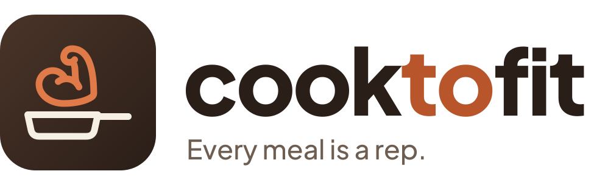

<p align="center"></p>
<p align="center"><b>Every meal is a rep.</b></p>

CookToFit is a home-cooking and nutrition coach that lives in **WhatsApp**, with a mobile-first web dashboard. It works out your macro and micronutrient targets, suggests dishes from your pantry, utensils and available time, logs meals from a photo or a quick text, and plans your week's cooking and shopping.

> Status: **Phase 0 (foundations)**. Invite-only and pre-launch.

## Repo layout
| Path | What |
|---|---|
| `apps/brain` | FastAPI backend: WhatsApp webhook, agents, nutrition engine (Python 3.12, uv) |
| `apps/web` | Next.js dashboard + PWA, mobile-first |
| `supabase` | Postgres migrations, seed, pgTAP tests |
| `docs` | PRD, architecture, ADRs |
| `assets/brand` | Logo, icons, design tokens |

## Quick start
Needs uv, Node 22+ and Docker. Full details in [docs/SETUP.md](docs/SETUP.md).
```bash
make install && make db-start && make db-reset
make brain   # :8000
make web     # :3000
make check   # what CI runs
```

## Docs
- [Setup](docs/SETUP.md) · [Product requirements](docs/PRD.md) · [Architecture](docs/ARCHITECTURE.md) · [Deep dive](docs/DEEP_DIVE.md) · [Plan](docs/PLAN.md)
- [Architecture decisions](docs/adr/README.md) · [Domain glossary](CONTEXT.md) · [Brand kit](assets/brand/README.md)

## Data attribution
Product data © [Open Food Facts](https://world.openfoodfacts.org/) contributors, available under the [Open Database License (ODbL)](https://opendatacommons.org/licenses/odbl/1-0/). See [NOTICE](NOTICE).
